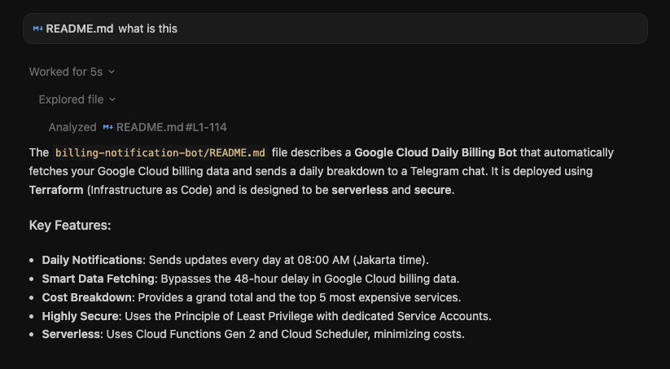
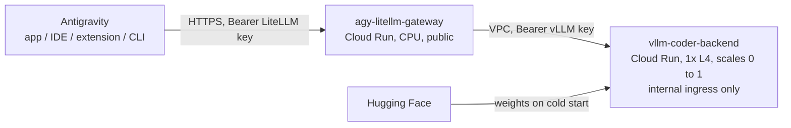
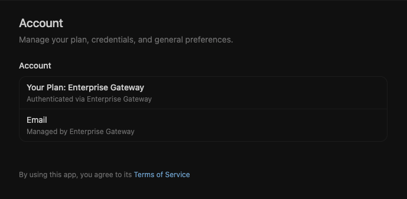
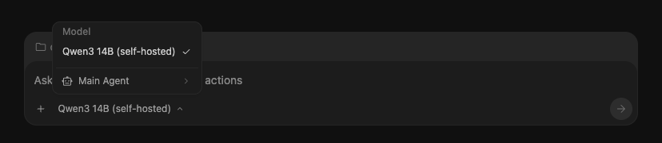

# Antigravity Self-Hosted Model on Cloud Run GPU

> [!CAUTION]
> **Proof of concept, not production code.** vLLM is private, but the LiteLLM gateway is public and protected only by a static API key. See [Hardening](#hardening) before using it for anything real.

Self-hosted `Qwen/Qwen3-14B-AWQ` on Cloud Run (1x NVIDIA L4) running vLLM, fronted by a LiteLLM gateway that Antigravity connects to with `wireProtocol: openai`.



## How it works



- **LiteLLM** exposes the model to Antigravity under the alias `oss-coder-gpu` and checks the gateway key.
- **vLLM** serves Qwen3-14B with tool calling enabled and thinking turned off. It accepts only internal traffic, which LiteLLM sends through a VPC subnet (Direct VPC egress). Requests from the internet are rejected before an instance starts, so they can't wake the GPU.
- **Terraform** creates everything. It generates the keys, stores them and the LiteLLM config in Secret Manager, and copies the container images into Artifact Registry with Cloud Build.

## Prerequisites

- Terraform >= 1.5, the `gcloud` CLI (used by the image mirror step) and `jq`
- A project with billing enabled and Cloud Run L4 GPU quota in the region
- Antigravity clients at or above the [tested versions](#tested-clients)

## Deploy

```bash
gcloud auth login
gcloud auth application-default login

cd iac
cp terraform.tfvars.example terraform.tfvars   # set project_id + pinned tags
terraform init
terraform apply                                # first apply includes a ~25 min image mirror
```

## Configure Antigravity

### Tested clients

Tested on macOS with the `openai` wire protocol:

| Client                  | Tested version           | Setup         |
| :---------------------- | :----------------------- | :------------ |
| Antigravity app         | 2.31.0                   | Option B      |
| Antigravity IDE         | 2.6.0                    | Option B      |
| Antigravity extension   | 1.11.0 (VS Code 1.145.3) | Option B      |
| Antigravity CLI (`agy`) | 1.5.5                    | Option A or B |

> [!TIP]
> If a client still shows the usual Google models after setup, update it first.

### Option A: environment variables (CLI, one terminal only)

From `iac/`:

```bash
export AGY_LLM_GATEWAY_URL="$(terraform output -raw gateway_url)"
export AGY_LLM_GATEWAY_API_KEY="$(terraform output -raw litellm_master_key)"
export AGY_LLM_GATEWAY_WIRE_PROTOCOL="openai"
export AGY_LLM_GATEWAY_MODELS="oss-coder-gpu"

agy -p "Read variables.tf and summarize it in 3 bullets"
```

Only this shell is affected. Close it to go back to normal.

### Option B: `admin_settings.json` (Antigravity app, IDE and extension, system-wide)

> [!WARNING]
> The file is system-wide. Every Antigravity client and every macOS user on the Mac goes through the gateway, users can't override it, and Google models stay unavailable until you remove the file.

From `iac/`, fill in the template (the result is gitignored), then install it as root. The commands below are for macOS. For Linux and Windows paths, or to roll the file out to many machines with MDM (Jamf, Intune, Ansible, …), see [Deploy settings using MDM](https://docs.cloud.google.com/gemini/enterprise/docs/ai-developer-tools/deploy-enterprise-gateway#deploy-mdm).

```bash
jq --arg url "$(terraform output -raw gateway_url)" \
   --arg key "$(terraform output -raw litellm_master_key)" \
   '.gateway.url = $url | .gateway.apiKey = $key' \
   ../antigravity/admin_settings.json.example > ../antigravity/admin_settings.json

sudo mkdir -p "/Library/Application Support/Antigravity"
sudo install -m 644 -o root -g wheel ../antigravity/admin_settings.json \
  "/Library/Application Support/Antigravity/admin_settings.json"
```

Restart Antigravity and check that **Settings → Account** shows **Your Plan: Enterprise Gateway**:



And that the model picker shows **Qwen3 14B (self-hosted)**:



To undo it:

```bash
sudo rm "/Library/Application Support/Antigravity/admin_settings.json"
```

Restart the clients, and the usual Google models come back.

## Smoke tests

From `iac/`. If vLLM has scaled to zero, the first model call takes 6-10 minutes (weights are downloaded from Hugging Face on every cold start).

```bash
VLLM_URL=$(terraform output -raw vllm_url)
GATEWAY_URL=$(terraform output -raw gateway_url)
LITELLM_MASTER_KEY=$(terraform output -raw litellm_master_key)

curl -s -o /dev/null -w "%{http_code}\n" "$VLLM_URL/health"                    # expect 404: vLLM is not reachable from the internet
curl -s -o /dev/null -w "%{http_code}\n" "$GATEWAY_URL/v1/models"               # expect 401
curl -s "$GATEWAY_URL/v1/models" -H "Authorization: Bearer $LITELLM_MASTER_KEY" # lists oss-coder-gpu
curl -s "$GATEWAY_URL/v1/chat/completions" -H "Authorization: Bearer $LITELLM_MASTER_KEY" \
  -H "Content-Type: application/json" \
  -d '{"model": "oss-coder-gpu", "messages": [{"role": "user", "content": "Reply with PONG"}]}' # gateway -> vLLM over the VPC
```

## Known issues

| Symptom                                           | Fix                                                                                                                                                           |
| :------------------------------------------------ | :------------------------------------------------------------------------------------------------------------------------------------------------------------ |
| Apply fails on a Cloud Run service (org policy)   | Org policy may block `invoker_iam_disabled`. The gateway needs it because Antigravity sends its own Bearer key, so request a policy exception for the project |
| Mirror step fails right after the SA is created   | IAM propagation delay; re-run `terraform apply`                                                                                                               |
| Gateway returns a 404 from vLLM right after apply | The internal ingress and VPC egress settings take a few minutes to take effect; retry after ~3 minutes                                                        |
| First request takes minutes / client timeout      | Warm up with the gateway chat `curl` from the smoke tests, or temporarily set vLLM `min_instance_count = 1` (an always-on L4 is billed)                       |
| vLLM startup probe fails                          | Hugging Face rate limits; add an `HF_TOKEN` secret env var                                                                                                    |

## Hardening

Already in place: vLLM accepts only internal traffic from LiteLLM over the VPC, plus its own API key.

Next steps for production:

1. **Gateway perimeter:** External ALB + Cloud Armor (IP allowlist, rate limits), or an Internal ALB over VPN.
2. **Per-developer keys:** LiteLLM virtual keys with budgets (needs Postgres, e.g. Cloud SQL).
3. **State and secrets:** a GCS backend with restricted access for Terraform state; rotate both keys.
4. **Optional, for zero-trust or shared-VPC requirements:** Cloud Run IAM between LiteLLM and vLLM (`roles/run.invoker` for the LiteLLM service account only). LiteLLM doesn't attach Google identity by itself, so something has to add a fresh ID token to each request in `X-Serverless-Authorization`, such as a LiteLLM hook or an auth sidecar. A static `api_key` in the config isn't enough, because ID tokens expire after an hour.

## Teardown

```bash
cd iac && terraform destroy
```

Mirrored images are deleted together with the Artifact Registry repo. APIs stay enabled.

If deleting the subnet fails with "in use", Cloud Run hasn't released the Direct VPC egress IPs yet. This can take a while after the service is deleted. Re-run `terraform destroy` later.
